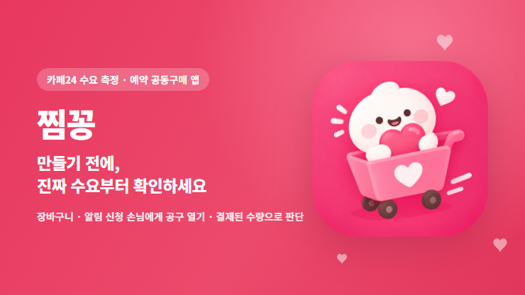
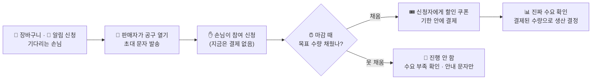
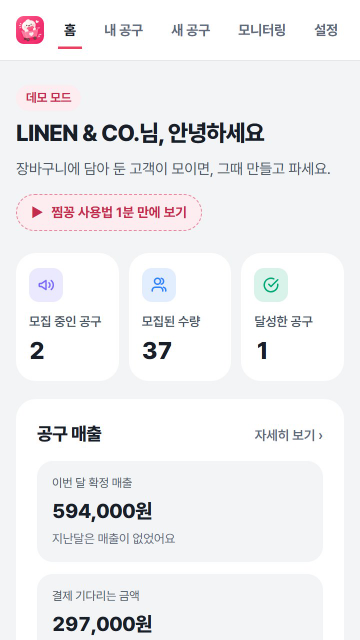
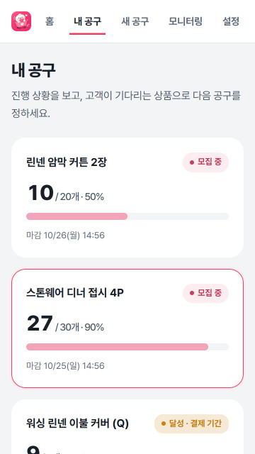
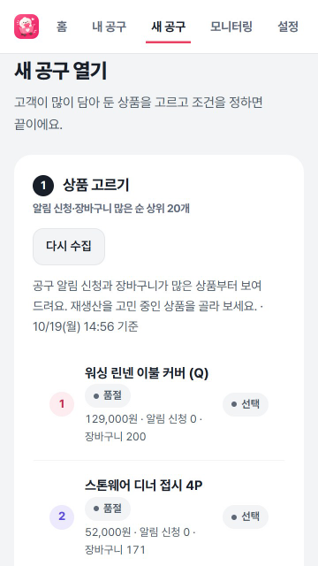
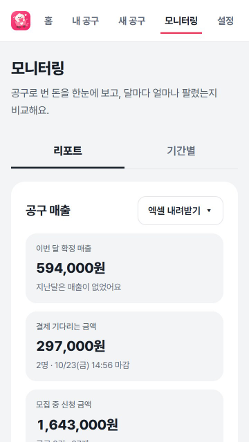
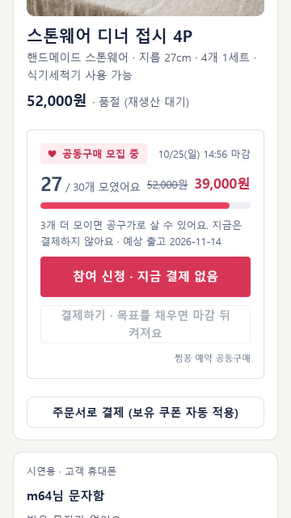

<div align="center">



# 찜꽁

**재입고 · 재생산 전에, 장바구니 · 알림 신청에 쌓인 수요를 결제된 숫자로 재 보는 카페24 예약 공동구매 앱**

결제 없이 신청받고 → 목표 수량을 채우면 쿠폰으로 결제받고 → **결제된 수량**을 보고 만들지 말지, 몇 개 만들지 정해요.

[🎬 시연 영상 (3분)](https://raw.githubusercontent.com/bobo33772-blip/HOP/pr-images/pr-105/demo.mp4) · [바로 실행해 보기](#-바로-실행해-보기) · [폴더 안내](#-폴더-안내)

</div>

---

## 🤔 어떤 문제를 푸나요?

작은 자체 브랜드(특히 홈리빙)는 잘 팔린 상품이 품절돼도 **다시 만들기가 겁나요.**
도자기 한 가마, 원단 한 롤처럼 최소 생산 단위가 커서, 다시 만들었다가 안 팔리면 그대로 재고가 되거든요.

그런데 쇼핑몰에는 이미 **"이거 사고 싶어요"라는 신호**가 쌓여 있어요.

- 🛒 장바구니에 담아 두고 기다리는 손님
- 🔔 품절 상품에 "재입고되면 알려 주세요"를 누른 손님

하지만 담기 · 알림 신청은 **관심**일 뿐이라, 이 숫자만 믿고 만들기엔 실제로 몇 명이 살지 알 수 없어요.

찜꽁은 이 손님들에게 **"몇 명이 모이면 공구가로 다시 만들게요"**라고 물어, 관심이 **진짜 수요(결제)**로 이어지는지 재 줘요. 판매자는 만들기 **전에** 그 숫자를 보고 정해요.

| 지금까지 | 찜꽁을 쓰면 |
|---|---|
| 감으로 재생산 수량을 정해요 | 결제된 수량을 보고 정해요 |
| 장바구니 · 알림 신청 수는 "관심"일 뿐 | 신청 → 결제까지 이어진 "진짜 수요"를 숫자로 봐요 |
| 다시 만들었는데 안 팔리면 재고 | 목표를 못 채우면 만들기 전에 수요가 부족한 걸 알아요 (손님도 돈 낸 적 없음) |
| 재입고 알림은 "들어왔어요" 한 번으로 끝 | 기다리던 손님이 공구로 모이고, 모일수록 할인 |

## 🔄 어떻게 돌아가나요?



1. **기다리는 손님 찾기** — 상품마다 장바구니 · 공구 알림 신청이 몇 명인지 보여 줘요.
2. **공구 열기** — 판매자가 목표 수량 · 공구가 · 마감일을 정하면, 문자 수신에 동의한 손님에게 초대 문자가 가요.
3. **결제 없이 신청** — 손님은 상품 페이지의 찜꽁 위젯에서 "참여 신청"만 눌러요.
4. **마감 판정** — 목표를 채우면 신청자에게만 1회용 할인 쿠폰을, 못 채우면 안내 문자만 보내요.
5. **쿠폰으로 결제** — 손님은 평소처럼 쇼핑몰에서 결제하고, 쿠폰이 공구가를 맞춰 줘요.
6. **수요 확인 → 생산 판단** — 결제가 끝난 수량이 진짜 수요예요. 판매자는 이 숫자로 만들지 말지, 몇 개 만들지 정해요.

## 👥 누가 어떻게 쓰나요?

| | 누구 | 어디서 | 하는 일 |
|---|---|---|---|
| 🩷 **판매자** | 쇼핑몰 사장님 | 카페24 관리자 › 앱 › 찜꽁 | 기다리는 상품 보기 · 공구 열기 · 진행률 · 매출 통계 · 엑셀 |
| 💙 **소비자** | 쇼핑몰 손님 | 상품 페이지의 찜꽁 위젯 | 공구 알림 받기 · 결제 없이 참여 신청 · 쿠폰으로 결제 |
| 💜 **관리자** | 찜꽁 운영팀 | 운영자 화면 | 파일럿 몰 함께 보기 · 공구 대신 열기 · 생산 결정 기록 · 4주 판정표 |

## 📱 화면

| 판매자 홈 | 내 공구 | 새 공구 열기 | 모니터링 (매출) | 손님이 보는 위젯 |
|:---:|:---:|:---:|:---:|:---:|
|  |  |  |  |  |

> 화면은 데모 쇼핑몰(LINEN & CO.)이에요. 실제 손님 정보는 없어요.
> 전체 흐름은 [🎬 시연 영상](https://raw.githubusercontent.com/bobo33772-blip/HOP/pr-images/pr-105/demo.mp4)에서 판매자 → 소비자 → 관리자 순서로 볼 수 있어요.

## ✅ 지켜 주는 것

- **손님 돈이 먼저 나가지 않아요.** 신청은 결제가 아니고, 목표를 채운 뒤에만 쿠폰으로 결제해요.
- **광고 문자 규칙**을 지켜요. `(광고)` 표기 · 080 무료수신거부 · 밤 9시~오전 8시 발송 금지 · 수신 동의 손님에게만.
- **개인정보를 최소로** 다뤄요. 쇼핑몰 회원 ID와 수량만 쓰고, 이름 · 전화번호 · 주소는 저장하지 않아요. 기한이 지나거나 탈퇴하면 자동으로 지워요.
- 판매자 이용료는 **무료**예요. 문자는 쇼핑몰의 카페24 SMS 잔액에서 나가요.

## 📍 지금 어디까지 왔나요? (2026년 10월)

| | 상태 |
|---|---|
| 공구 엔진 · 판매자 화면 · 관리자 화면 · 손님 위젯 | ✅ 완성 (데모 쇼핑몰에서 처음부터 끝까지 동작) |
| 운영 서버 | ✅ Vercel 서울 · Supabase 서울. `main`에 머지하면 검사 뒤 자동 배포 |
| 실제 카페24 쇼핑몰 연결 | ✅ 앱 설치 · 쿠폰 생성 · 위젯 확인 |
| 카페24 앱스토어 출시 | ⏳ 준비 중 |
| 파일럿 | ⏳ 홈리빙 판매자와 4주 파일럿 준비 중 — 목표: **결제된 수량으로 생산을 결정한 판매자 1곳** |

## 🚀 바로 실행해 보기

키나 카페24 계정 없이 **데모 모드**로 처음부터 끝까지 돌아가요.

```bash
cd jjim-gonggu/app
corepack pnpm install
corepack pnpm dev -p 3100
```

`http://localhost:3100/demo` 를 열면 판매자 · 소비자 · 관리자 중 하나를 골라 들어갈 수 있어요.
모의 쇼핑몰이라 실제 문자 · 결제는 일어나지 않고, 서버를 다시 켜면 처음부터 시작해요.

```bash
corepack pnpm test        # 공구 흐름 · 광고 문자 규칙 · 카페24 연동 · 화면 주소 테스트
corepack pnpm typecheck
```

## 🗂 폴더 안내

| 경로 | 내용 |
|---|---|
| [`jjim-gonggu/app/`](jjim-gonggu/app/README.md) | **찜꽁 서버** — 판매자 화면 · 관리자 화면 · 손님 위젯 · 공구 엔진을 한 서버에서 |
| [`jjim-gonggu/app/docs/`](jjim-gonggu/app/docs/) | 단계 계획(ROADMAP) · 화면 규칙(DESIGN) · 카페24 설정 · 배포 안내 |
| [`jjim-gonggu/store/`](jjim-gonggu/store/README.md) | 카페24 앱스토어 제출 자료 (설명 · 권한 소명 · 스크린샷) |
| [`jjim-gonggu/plans/`](jjim-gonggu/README.md) | 기획서 (팀원용 · 투자자용) |

**만든 것**: Next.js 16 · React 19 · TypeScript · Drizzle ORM · PostgreSQL(Supabase) · Vitest · Vercel · 카페24 Open API

## 🤝 작업 방식

- 이슈 하나 = PR 하나. 다른 사람이 승인해야 `main`에 들어가요.
- PR마다 자동 검사(타입 검사 · 테스트 · 빌드)를 통과해야 해요.
- 화면 · 문구에서 정한 것은 [`DESIGN.md`](jjim-gonggu/app/docs/DESIGN.md)에 PR 번호와 함께 적어요.

## 🔒 보안

공개 저장소예요. `.env` · 카페24 Client Secret · `TOKEN_ENC_KEY` · `ADMIN_TOKEN` 같은 비밀값은 **절대 커밋하지 않아요.**
실수로 올렸다면 커밋을 지우는 것만으로는 부족하니, 바로 키를 새로 발급해 주세요.
